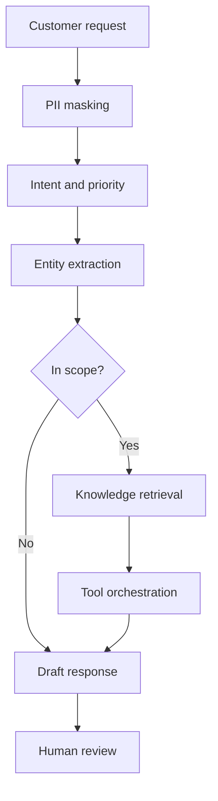

# DanaShift | Applied NLP
**Multilingual customer support agent for technical consulting**

Developed as part of the **Applied Natural Language Processing Program** offered by **SDAIA Academy**, affiliated with the Saudi Data and Artificial Intelligence Authority (SDAIA).

[**Try the Live Demo**](https://danaalotaibi11.github.io/DanaShift-NLP/demo/workspace.html) · [Project Notebook](DanaShift.ipynb)

## Overview
DanaShift combines privacy-aware text preprocessing, Arabic language modeling, intent classification, entity annotation, semantic retrieval and human-supervised customer support workflows.

## Experimental methodology
| Stage | Focus | Recorded result |
|---|---|---|
| 1 | Normalization, PII masking, multilingual tokenization | Arabic fertility 3.32; English 1.95; p95 length 36.5; UNK rate 0.0058 |
| 2 | Attention, masking and CAMeLBERT attention maps | PAD attention with mask 0.0; without mask 0.294 |
| 3 | CAMeLBERT classification, grouped split | Saved split: 6 train rows, 2 test rows, no shared client IDs; counts require revalidation; eval loss 3.3970 |
| 4 | BIO alignment and Arabic morphology | 8/8 alignment tests; 9/9 illustrative labels |
| 5 | MiniLM embeddings, FAISS and CrossEncoder | Example rank 2 before reranking, rank 1 after reranking |
| 6 | Sliced evaluation and error analysis | Illustrative bootstrap interval 0.375–1.0 |

These are saved notebook outputs and small exercises, not production benchmarks. The classification experiment trained four labels; automation and out-of-scope are proposed extensions. The entity annotation experiment's illustrative labels and manually specified F1 values are not measured model performance. The evaluation example uses supplied labels and predictions.

## Proposed workflow

## Project notebook

[**Open DanaShift.ipynb**](DanaShift.ipynb) — unified project explanation, code, saved experimental results and original Colab figures.

## Repository guide
- [Experiment notes](docs/experiments.md)
- [Interactive live demo](https://danaalotaibi11.github.io/DanaShift-NLP/demo/workspace.html) — browser-based simulated workflow, not live model inference.

## Acknowledgments
SDAIA Academy, Saudi Data and Artificial Intelligence Authority, for the Applied Natural Language Processing Program.

This educational project is not an official SDAIA product. No customer messages are sent automatically.
