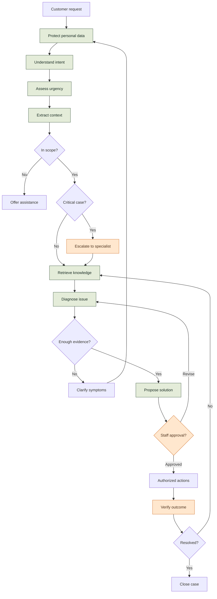

# DanaShift

**Multilingual AI Support Agent**

*From customer messages to intelligent problem resolution.*

[Live Demo](https://danaalotaibi11.github.io/DanaShift-NLP/demo/workspace.html) &nbsp;·&nbsp; [Presentation](https://www.canva.com/d/aEq6WDan0hOMRJO) &nbsp;·&nbsp; [Notebook](DanaShift.ipynb) &nbsp;·&nbsp; [Architecture](docs/architecture.md)

`Arabic & English` &nbsp; `Applied NLP` &nbsp; `Human-in-the-loop`

Developed as part of the **Applied Natural Language Processing Program** at **SDAIA Academy**, affiliated with the Saudi Data and Artificial Intelligence Authority (SDAIA).

---

## 01 / The challenge

Technical support teams receive requests in different languages, dialects and levels of urgency. Manual triage consumes staff time, investigations may be repeated, and critical requests can get buried among routine messages.

**Sorting a request is not the same as solving it.**

## 02 / From inbox to resolution

DanaShift is envisioned as an AI-powered support agent that understands customer problems in context, retrieves relevant technical knowledge, identifies potential causes and recommends practical solutions. Its purpose is to help staff and customers move from the initial message toward resolution, not simply forward tickets.

The target scope includes cybersecurity, cloud and infrastructure support, automation projects, meetings and proposals, with appropriate handling of out-of-scope requests.

| Intended capability | Intended value |
|---|---|
| Arabic dialects and English understanding | Reduce language barriers and interpret informal requests |
| Contextual analysis and troubleshooting | Identify likely causes and ask useful follow-up questions |
| Knowledge-grounded recommendations (RAG) | Reuse approved technical guidance and prior cases |
| Privacy-aware processing | Reduce unnecessary exposure of personal information |
| Authorized tool integration | Coordinate support tasks and case follow-up |
| Human oversight | Escalate critical or uncertain cases and approve consequential actions |

These are development goals; business impact has not yet been measured.

## 03 / AI resolution pipeline

This is the proposed future workflow, not a claim of an integrated production system. The current browser prototype demonstrates initial triage and suggested actions using rules; it does not run trained models, perform live diagnosis, execute tools or send messages.

## 04 / A customer story

> Our system keeps crashing after the latest update. Can you help identify the cause and restore service?

The envisioned agent would clarify symptoms, retrieve relevant documentation, reason about potential causes, propose troubleshooting steps, request approval for consequential actions and follow up to verify the outcome. If evidence is insufficient or specialist input is needed, the case is escalated rather than presenting a speculative diagnosis as fact.

## 05 / Experimental foundations

| Component | Recorded observation |
|---|---|
| Multilingual tokenization | Arabic fertility 3.32 vs English 1.95 on six examples; unknown token rate 0.58%; p95 length 36.5 |
| Attention masking | Padding attention 0 with mask vs 0.294 without mask |
| CAMeLBERT fine-tuning | Four intent labels; 16 source examples; saved evaluation loss 3.3970; split counts require revalidation |
| BIO alignment | 8/8 alignment checks passed; not a measure of trained NER accuracy |
| Semantic retrieval | MiniLM, FAISS and CrossEncoder; relevant candidate moved from rank 2 to 1 in a supplied candidate example |
| Evaluation | Illustrative bootstrap interval 37.5%–100% on supplied predictions, not a trained model benchmark |

These observations come from saved notebook experiments and small illustrative samples, not production performance benchmarks. The separate FAISS example already retrieved the relevant incident first; the reranking comparison uses a separately supplied candidate order.

## 06 / Development roadmap

| Stage | Focus |
|---|---|
| Current | NLP experiments and browser-based workflow prototype |
| Next | Validate multilingual datasets, rerun grouped training, export model checkpoints and integrate semantic retrieval |
| Future | Contextual reasoning, multi-turn troubleshooting, grounded recommendations and authorized tool execution |
| Validation | Measure resolution quality, response time, routing accuracy and staff workload against a manual baseline |

## 07 / Explore the project

- [Project presentation — illustrated case study](https://www.canva.com/d/aEq6WDan0hOMRJO) — challenge, vision, workflow and experimental foundations.
- [DanaShift.ipynb](DanaShift.ipynb) — methodology, code, charts and experimental results.
- [Architecture and workflow](docs/architecture.md) — target design and operational safeguards.
- [Experiment notes](docs/experiments.md) — supporting technical observations.
- [Interactive live demo](https://danaalotaibi11.github.io/DanaShift-NLP/demo/workspace.html) — initial workflow preview.

## Acknowledgments

SDAIA Academy — Applied Natural Language Processing Program, Saudi Data and Artificial Intelligence Authority (SDAIA).

DanaShift is an educational project, not an official SDAIA product.
