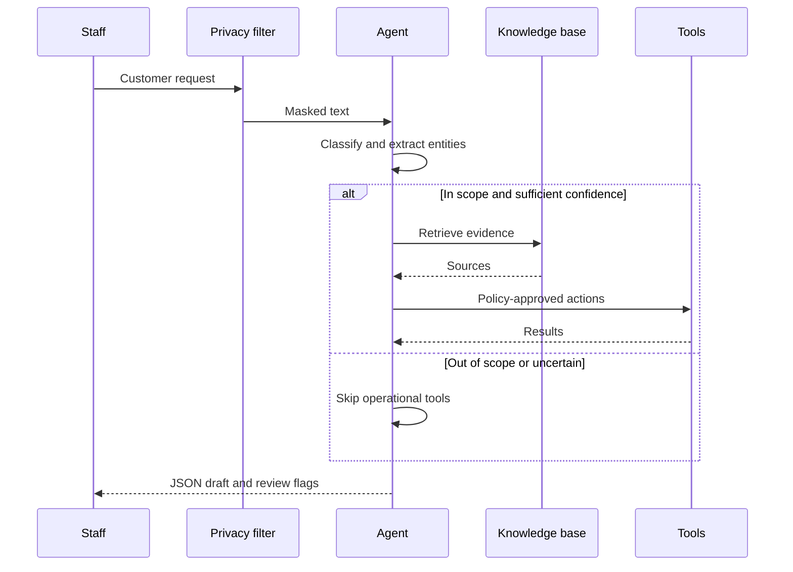

# Proposed architecture

The browser demo is a rule-based sandbox. Production integration requires trained model checkpoints, verified knowledge sources, authenticated tool adapters and authorization controls.
