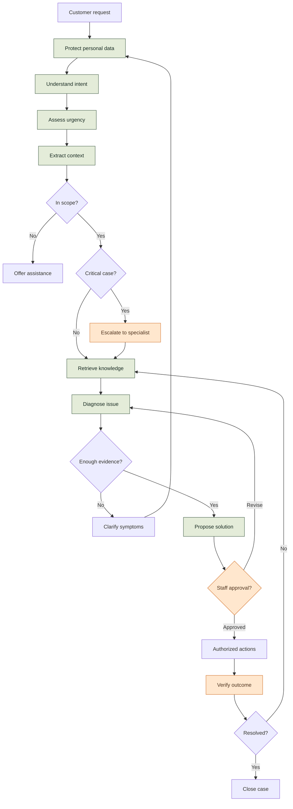
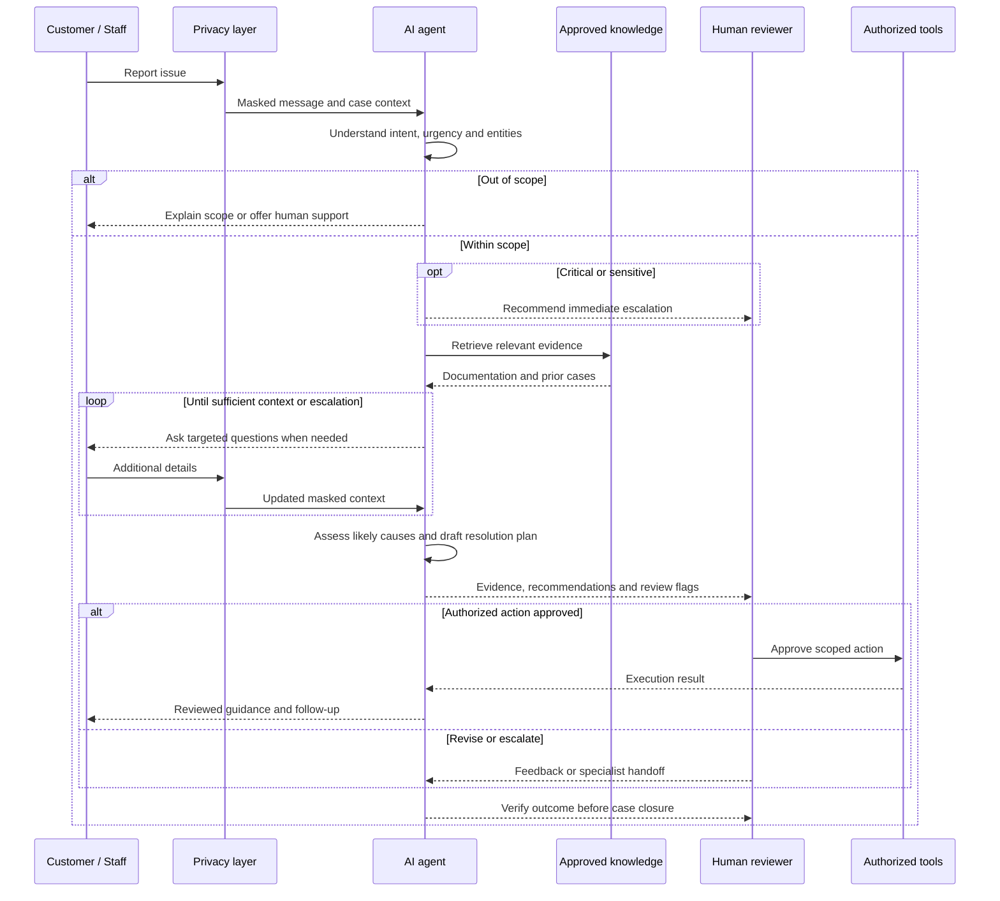

# DanaShift — AI resolution architecture

## Target workflow

## Proposed interaction sequence

## Implementation boundary

The notebook explores masking, classification, entity alignment, semantic search and evaluation. The browser prototype is rule-based and does not execute the target sequence. Model checkpoints, grounded reasoning, multi-turn case state, verified knowledge, authenticated adapters and authorization controls are future integration work.

Critical or uncertain cases require specialist review. Recommendations must be evidence-grounded; actions must be explicitly authorized and outcomes verified before marking cases resolved.
